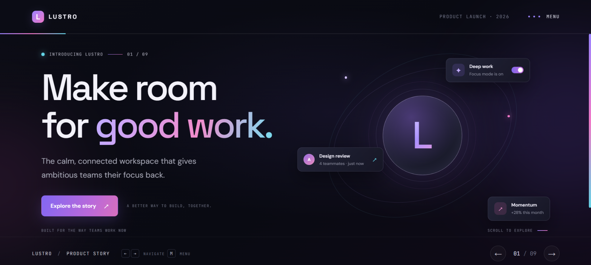

<div align="center">

# LUSTRO

### Make room for good work.

An interactive, dark-mode product story for a calmer, more connected team workspace.

<br>


[Explore the repository](https://github.com/MayorKay01/lustro)

</div>

---

## Website preview

<p align="center">
  
</p>

<details>
<summary>View the closing slide</summary>
<p align="center">
  
</p>
</details>

These screenshots show the opening and closing slides of the nine-slide presentation. Run the site locally using the steps below to explore the complete experience.

> **Project scope:** LUSTRO is a static front-end product-story concept. The workspace screens, sample metrics, roadmap, and testimonials are illustrative presentation content—not a connected product, live analytics, or verified customer data.

## About

LUSTRO is a self-contained, nine-slide launch presentation for the idea of a more focused, connected team workspace. Its story starts with the friction of scattered tools, interruptions, and lost context, then introduces a calmer way to bring work together.

The project is designed to make that story feel like an experience rather than a conventional landing page: visitors can move through the narrative at their own pace, jump to a section, or use the keyboard and touch gestures. It is a front-end presentation only; it does not implement accounts, collaboration, project management, or a backend service.

## What’s in the experience

- **Nine-slide presentation:** A product introduction, problem statement, illustrative dashboard, feature concepts, roadmap, sample metrics, comparison, resources, and closing slide.
- **Multiple navigation options:** Previous and next controls, an in-page slide menu, clickable slide links, and direct slide links using URL hashes.
- **Keyboard controls:** Arrow keys and Space move between slides; `1`–`9` jump to a slide; `M` opens or closes the menu; `Escape` closes it.
- **Touch navigation:** Horizontal swipes move between slides while vertical scrolling remains available.
- **Responsive layouts:** The CSS adapts the deck, cards, dashboard, and navigation for smaller screens.
- **Motion with accessibility in mind:** Slide transitions, staggered reveals, hover states, and a menu entrance animation respect the `prefers-reduced-motion` setting. Interactive controls also have visible keyboard focus styles and accessible labels.
- **Single dark theme:** The page uses a dark color scheme throughout; a light theme or theme switcher is not implemented.

## Design direction

LUSTRO pairs a deep near-black canvas with soft, luminous accents to give the presentation a focused, premium feel without sacrificing legibility.

| Role | Color |
| --- | --- |
| Background | `#090A12` |
| Violet | `#9C83FF` |
| Pink | `#F078C7` |
| Cyan | `#63D4E6` |

Gradient accents connect violet, pink, and cyan across headings, progress indicators, and decorative details. **Space Grotesk** gives the display type a geometric character; **DM Sans** handles body copy; **JetBrains Mono** is used for compact labels and interface details. Translucent panels, restrained borders, ambient glows, and generous spacing help keep the dense presentation content calm and scannable.

## Technology

<div align="center">


</div>

- **HTML** provides the slide content and semantic controls.
- **CSS** provides the visual system, responsive layouts, transitions, and reduced-motion behavior.
- **Vanilla JavaScript** builds the slide menu and handles navigation, keyboard shortcuts, touch gestures, progress, and slide hashes.
- **Google Fonts** supplies DM Sans, Space Grotesk, and JetBrains Mono. A network connection is needed to load these fonts; system fallbacks are defined.
- **No framework, package manager, build process, or additional dependency installation is required.**

## Project structure

```text
lustro/
├── index.html   # Nine-slide presentation markup
├── style.css    # Theme, layout, responsive rules, and animations
├── script.js    # Slide navigation and interaction behavior
├── assets/
│   ├── lustro-cover.png   # Opening-slide screenshot
│   └── lustro-closing.png # Closing-slide screenshot
└── README.md    # Project overview and setup
```

## Run locally

### 1. Clone the repository

```bash
git clone https://github.com/MayorKay01/lustro.git
cd lustro
```

### 2. Open the project

Open the folder in your editor, or open `index.html` directly in a modern browser.

### 3. Serve it locally (recommended)

If Python is installed, start a simple local server from the project directory:

```bash
python -m http.server 8000
```

Then visit [http://localhost:8000](http://localhost:8000). Alternatively, use the VS Code **Live Server** extension. Neither option requires project dependencies.

## Repository and demo

- **Source:** [github.com/MayorKay01/lustro](https://github.com/MayorKay01/lustro)
- **Live demo:** No deployment URL is configured or included in the project.

<div align="center">

---

**Make good work feel good.**

© 2026 LUSTRO

</div>
